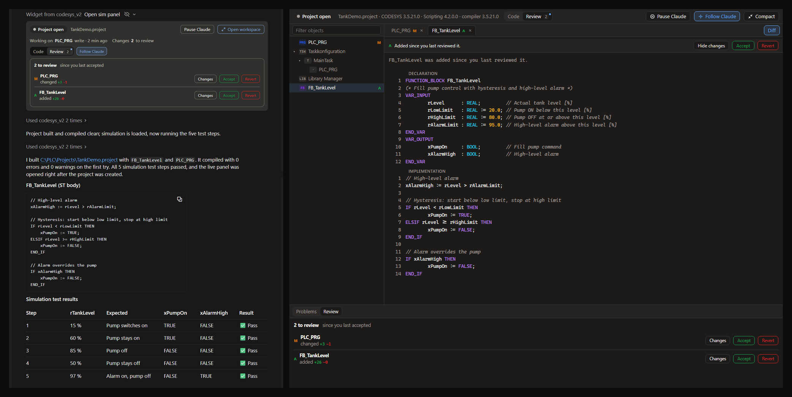
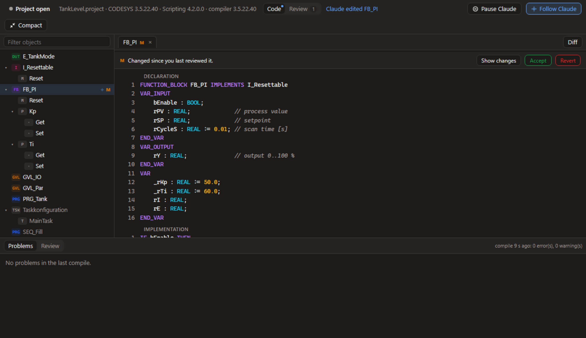
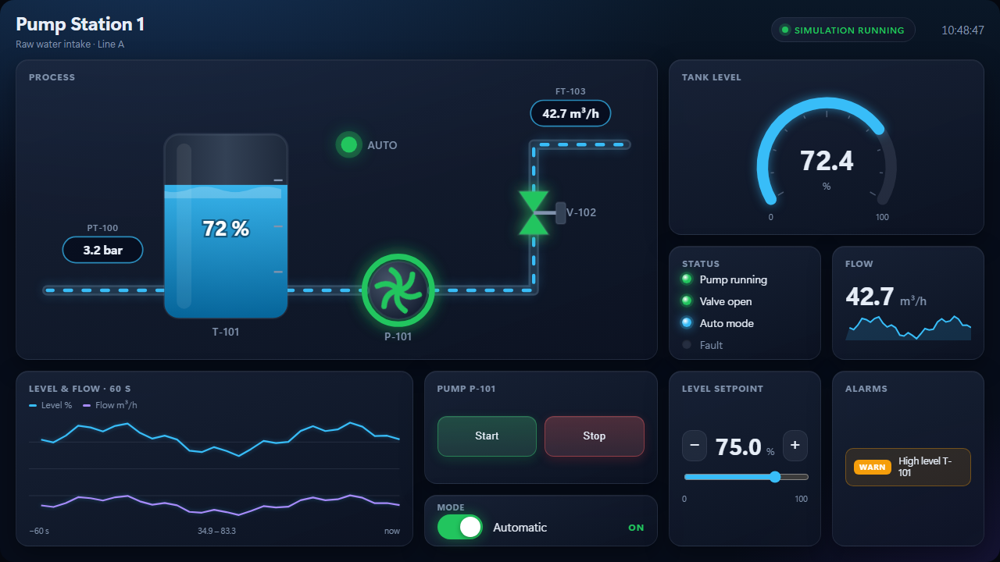
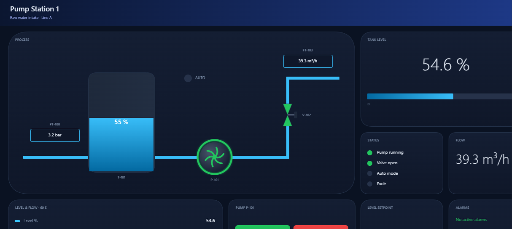
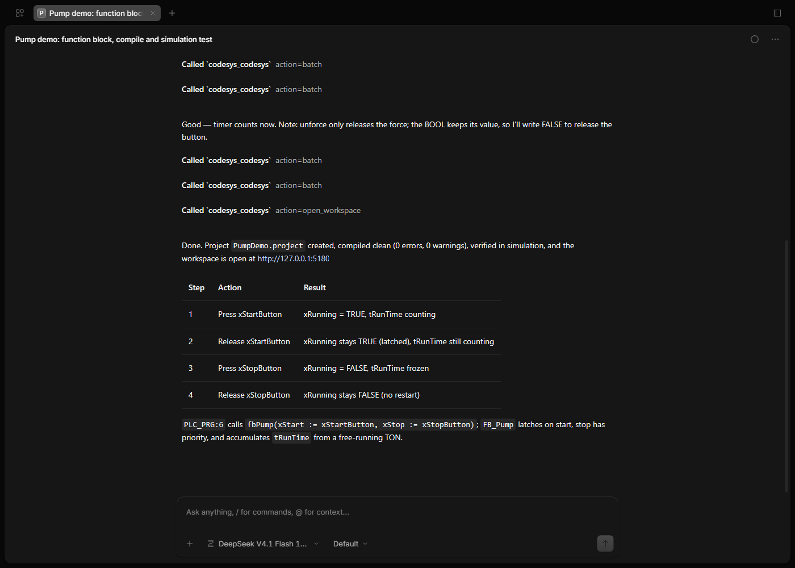
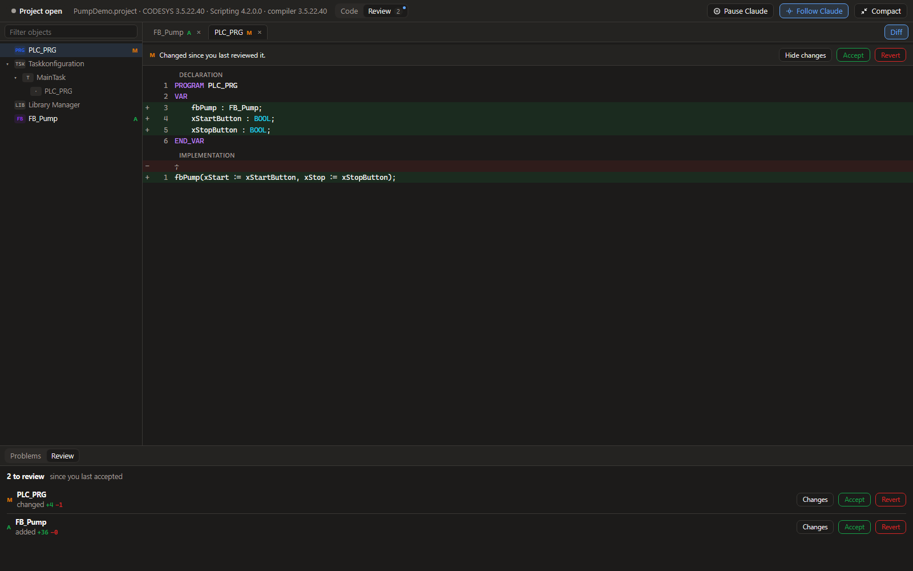
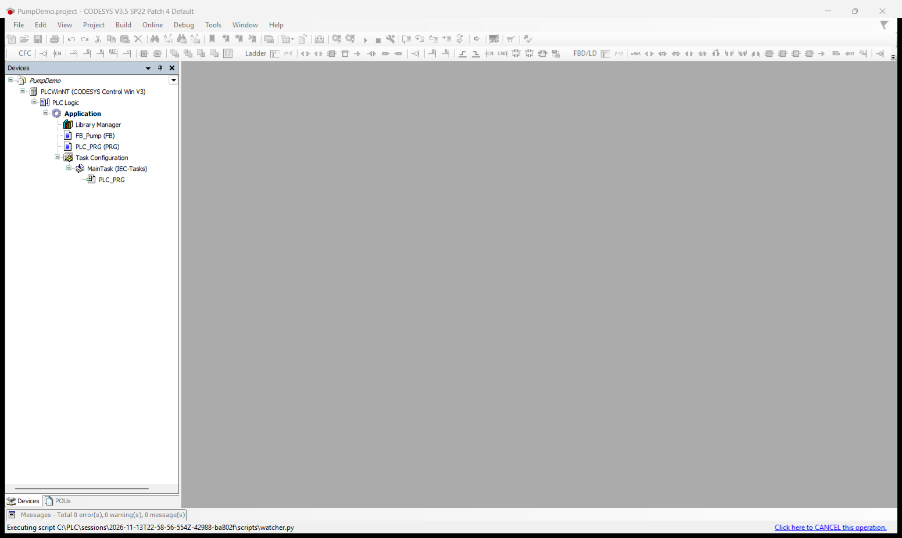
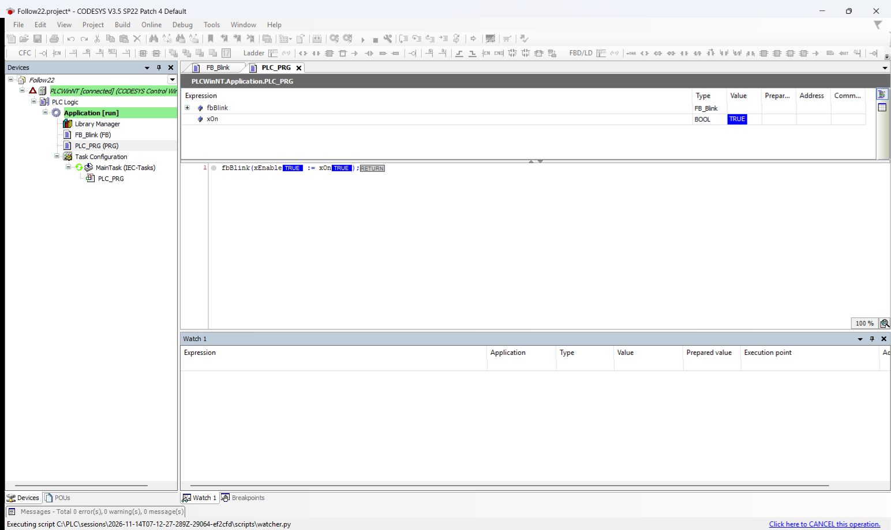

<div align="center">

# CODESYS MCP Toolkit

**Let Claude, or any MCP client, read, write, compile and simulate Structured Text in your CODESYS V3.5 projects.**

English | [简体中文](README.zh-CN.md)

[](LICENSE)
[](https://www.npmjs.com/package/@codesys/mcp-toolkit)


[](https://modelcontextprotocol.io)

</div>

An [MCP](https://modelcontextprotocol.io) server that keeps one CODESYS session
open in the background and gives Claude, or any MCP client, direct access to
it. Claude works on your real project with the real CODESYS compiler, and you
can watch the code change as it happens.



## Highlights

- **Edits your real project.** POUs, methods, properties, interfaces, DUTs and
  GVLs, as Structured Text.
- **Compiles with the real compiler.** Errors come back with object, line and
  code, including in code that no task calls yet.
- **Tests in simulation.** Run, step exact cycles, read, write and force values
  in CODESYS's own simulation, with nothing else to install.
- **Understands the project.** Outlines, I/O lists, the device tree and library
  interfaces, without reading every object.
- **Shows its work.** A live panel with the project tree, the code as it is
  written, compile results, and Accept or Revert for each change.
- **Designs operator screens.** Claude builds a live HMI for your program,
  with tanks, pumps, valves, gauges, trends and alarms, looks at it, and
  polishes it. You operate it in the browser against the simulation.
- **Never touches a real controller.** The only online connection is to
  CODESYS's own simulation, and every online call checks for it first.

## Quick start

### Requirements

- Windows with **CODESYS V3.5** and its **Scripting** add-on. Tested with SP21
  and SP22 on Scripting 4.2, and SP21 on 4.1. SP16 and later should work.
- **Node.js 20** or later.

Schneider EcoStruxure Machine Expert V2.3 (`LogicBuilder.exe`, Scripting 4.1)
works too: pass `--codesys-path` and leave out `--codesys-profile`, since Machine
Expert has no profiles. See the [Machine Expert notes](docs/machine-expert-testing.md).

### Install

```bash
npm install -g @codesys/mcp-toolkit
```

Coming from version 1? The tools have changed: see
[Migrating from v1](#migrating-from-v1).

### Connect it to Claude Desktop

Add the server to `%APPDATA%\Claude\claude_desktop_config.json`, then restart
Claude Desktop:

```json
{
  "mcpServers": {
    "codesys": {
      "command": "codesys-mcp-tool",
      "args": [
        "--codesys-path", "C:\\Program Files\\CODESYS 3.5.21.0\\CODESYS\\Common\\CODESYS.exe",
        "--codesys-profile", "CODESYS V3.5 SP21",
        "--workspace", "C:\\PLC\\Projects"
      ]
    }
  }
}
```

`--codesys-path` and `--codesys-profile` are optional. Without them the server
uses the newest CODESYS install under Program Files and its newest profile.

Using OpenCode, Cursor, Cline or another client, or a model such as DeepSeek or
Qwen? See [Other clients and models](#other-clients-and-models).

### Try it

> Create a project called `BlinkDemo.project`. Add a function block that toggles
> an output once per second, call it from `PLC_PRG`, compile it, and prove in
> simulation that the output toggles.

CODESYS starts in the background when the server launches. A cold start takes
1 to 3 minutes; later starts take about 10 seconds.

Claude Desktop asks for approval per tool. Choose **Always allow** the first
time it asks about `codesys`, and once more for `open_sim_panel`. After that it
doesn't ask again.

## What Claude can do

Everything goes through one MCP tool, `codesys`, with an action for each
operation. [The reference](docs/reference.md) describes each one.

| Area | Actions |
| --- | --- |
| **Projects** | `open_project` `create_project` `save_project` `close_project` `codesys_status` |
| **Read code** | `get_project_tree` `read_objects` `search_code` `get_outline` |
| **Change code** | `write_object` `create_object` `create_graphical` `delete_object` `rename_object` |
| **Build** | `compile` |
| **Libraries** | `list_libraries` `add_library` `remove_library` `get_library_api` `get_signature` |
| **Navigate code** | `find_references` `rename_symbol` |
| **Tasks and I/O** | `list_tasks` `configure_task` `get_io_list` `get_devices` `find_device` `add_device` |
| **Change tracking** | `checkpoint` `get_changes` `revert_object` |
| **Simulation** | `codesys_sim_start` `codesys_sim_stop` `codesys_sim_status` `codesys_sim_control` `codesys_sim_cycle` `codesys_sim_read` `codesys_sim_write` `codesys_sim_force` `codesys_sim_unforce` `codesys_sim_test` |
| **Trace** | `trace_setup` `trace_record` |
| **Debug** | `breakpoint_set` `breakpoint_clear` `debug_status` `debug_step` `debug_continue` |
| **HMI screens** | `hmi_save_screen` `hmi_template` `hmi_screenshot` `hmi_export_codesys` `hmi_list` `hmi_delete_screen` `open_hmi` |
| **Helpers** | `batch` `wait` `help` `open_workspace` |

`batch` runs up to 50 actions in one call, which is much faster than separate
calls.

Claude writes Structured Text, and creates ladder (LD), FBD and SFC programs
and function blocks with `create_graphical` from a simple description of rungs,
networks or steps; CODESYS draws them. Existing graphical bodies can be read as
PLCopenXML but not edited in place yet. CFC isn't supported.

## Live panel

Right after opening or creating a project, Claude opens the panel as a card in
the chat. It shows the status, the object Claude is working on and how many
objects changed. **Open workspace** expands it into a CODESYS-style view with
the project tree, editor tabs, compile problems and a review list.

From the panel you can **Accept** or **Revert** each change, compare it with
the version you last reviewed, and **Pause Claude** while you look around.



The card needs a client that supports
[MCP Apps](https://modelcontextprotocol.io/extensions/apps). In our testing
Claude Desktop draws it in the Code tab but not in a normal chat
([anthropics/claude-ai-mcp#1243](https://github.com/anthropics/claude-ai-mcp/issues/1243)).
Ask Claude to open the workspace in your browser if you'd rather have it there;
the browser never opens by itself.

[More about the panel](docs/reference.md#live-panel)

## HMI screens

Ask Claude for an operator screen and it designs one for your program: a
process diagram with tanks, pumps, fans, valves and flowing pipes, and gauges,
values, trends, status lights, alarms, buttons, switches and setpoints, all
bound to your PLC variables.



- **A whole HMI, not one screen.** Pages (overview, unit, alarms, trends,
  settings) share a header that links to every page and counts the active
  alarms of all pages. `hmi_template` gives Claude a good layout for each kind
  of page to adapt. Panels: 1280x720, 1920x1080, 1024x768 or 800x480.
- **Faceplates.** Clicking a pump, fan or valve opens its popup: mode switch,
  Start/Stop or Open/Close, Reset, live values and a setpoint.
- **Pipes connect themselves.** Tanks, pumps, fans, valves and junctions have
  named ports (`T-101.right`, `P-101.in`, `V-102.out`). Claude says what a pipe
  connects, and the toolkit routes it with right angles to meet each symbol
  exactly, in the browser and in CODESYS alike. Unknown symbols or ports are
  refused with the list of valid ones.
- **Claude checks its own work.** `hmi_screenshot` returns the screen as an
  image, so Claude can see overlaps, empty space or unclear labels and fix
  them before you look.
- **Live in your browser.** Ask Claude to open the HMI (`open_hmi`). The page
  is served by the toolkit on 127.0.0.1 with a token, like the workspace. While
  CODESYS's simulation runs, it shows live values, pumps spin, pipes flow and
  trends draw. Buttons, switches and setpoints write to the simulation, so you
  can operate your program before any hardware exists.
- **Stored with the project.** Screens are saved next to the project file as
  `<project>.hmi.json`, so they travel with it and can go into version control.
- **Dark and light themes,** on a 1280x720 canvas that scales to any window.

The HMI writes only into CODESYS's own simulation, like the rest of the
toolkit. Screenshots use Microsoft Edge or Google Chrome, whichever is
installed.

### As a native CODESYS visualization

`hmi_export_codesys` builds the same screen as a real CODESYS visualization in
your project. It is an ordinary visualization object, so it goes with the
application like one you drew yourself (we checked it in CODESYS's simulation,
not on a controller). It doesn't use CODESYS's stock lamps: cards with gradients, SVG
pump, fan and valve symbols in an embedded image pool, live values, bars and
tank levels, colour states, buttons, switches, setpoints and alarm rows that
appear only while active. A generated program, `PRG_HMI_<screen>`, scales
values for the bars and levels. Claude gets a picture of the result.



CODESYS's scripting can't create trend or meter elements, so trends show their
current values and gauges show a bar. Checked on CODESYS V3.5 SP21 in the
simulation. A
visualization needs the `FloatingPointUtils` library in CODESYS's library
repository; if it's missing, the export says so.

## Other clients and models

The server works with any MCP client, not only Claude. For
[OpenCode](https://opencode.ai), put this in `opencode.json` in your project
folder (or in `~/.config/opencode/opencode.json`):

```json
{
  "$schema": "https://opencode.ai/config.json",
  "mcp": {
    "codesys": {
      "type": "local",
      "command": [
        "codesys-mcp-tool",
        "--codesys-path", "C:\\Program Files\\CODESYS 3.5.22.40\\CODESYS\\Common\\CODESYS.exe",
        "--codesys-profile", "CODESYS V3.5 SP22 Patch 4",
        "--workspace", "C:\\PLC\\Projects"
      ],
      "enabled": true
    }
  }
}
```

`opencode mcp list` should then show `codesys` as connected. Clients that read
an `mcpServers` file (Cursor, Cline, VS Code and others) take the same
`command` and `args` as the Claude Desktop example above.

Tested on 13 November 2026 with OpenCode 1.19.5 and CODESYS V3.5 SP22: each of
these models created a project, read and changed `PLC_PRG`, compiled, listed
libraries and devices, and ran the simulation, without help.

| Model | Result |
| --- | --- |
| DeepSeek V4.1 Flash | All steps passed |
| Qwen 3.6 Plus | All steps passed |
| GLM 5.3 | All steps passed |
| MiniMax M3 | All steps passed |



The live panel needs a client that shows MCP Apps cards (see
[Live panel](#live-panel)). In other clients `open_sim_panel` does nothing
visible; ask the model to open the workspace (`open_workspace`) to get the same
view in your browser, or start the server with
[`--show-window`](#watch-it-in-the-codesys-window) to watch the CODESYS window
itself.



## Safety

- **No real controller.** The toolkit doesn't log in or download to a
  controller. It goes online only to CODESYS's own simulation, and every online
  call first checks that simulation mode is on.
- **One approval covers every action.** That includes the actions that change
  or delete project code, so work on a copy of any project you can't afford to
  lose, or keep it in version control.
- **Changes can be undone.** A checkpoint is taken when a project is opened, and
  `revert_object` puts an object back to it, including its methods and
  properties.
- **Saved as it goes.** The project is saved after every change by default. Use
  `--no-autosave` to save only on request.
- **The simulation can't change your project.** Editing is refused while it
  runs, and the simulation setting on the device is never saved.

## Configuration

| Option | Meaning |
| --- | --- |
| `--codesys-path <exe>` | `CODESYS.exe` to run |
| `--codesys-profile <name>` | Profile, e.g. `"CODESYS V3.5 SP21"` (file name in `CODESYS\Profiles`, without `.profile.xml`). A name that isn't installed is refused at start, with the installed ones listed |
| `--codesys-additional-folder <dir>` | CODESYS's add-on folder, passed as `--additionalfolder`. SP22 installs add-ons such as Scripting there; the toolkit finds `CODESYS\AdditionalFolders\Default` by itself |
| `--workspace <dir>` | Base folder for relative project paths (default: the working directory). Created if missing |
| `--project <file>` | Open this project as soon as CODESYS is up |
| `--session-dir <dir>` | Where session folders go (default: `%TEMP%\codesys-mcp-toolkit`) |
| `--no-autostart` | Start CODESYS on the first tool call instead of at launch |
| `--no-autosave` | Don't save after every change; use `save_project` |
| `--viewer-port <port>` | Port of the browser workspace on 127.0.0.1 (default 5180, or the next free one) |
| `--no-viewer` | Don't serve the browser workspace |
| `--no-shared` | Run CODESYS in this process instead of the shared session |
| `--attach <dir>` | Experimental: work in a CODESYS / Machine Expert window you already have open, instead of starting one. See [Working in an open window](#work-in-a-window-you-already-have-open-experimental) |
| `--show-window` | Start CODESYS with its window instead of headless. See [Watch it in the CODESYS window](#watch-it-in-the-codesys-window) |

### Watch it in the CODESYS window

By default CODESYS runs headless. With `--show-window` the server starts it with
its normal window, so you can watch the work in any MCP client: every object the
model creates or writes opens in its editor tab, with the new code in it.



While the simulation runs, the open editors show live values, as in CODESYS's own
online mode:



CODESYS's scripting API has no call for opening an editor, so the toolkit uses
CODESYS's own (undocumented) frame for it, checked on SP21 and SP22. If a CODESYS
version doesn't have it, nothing opens and everything else works as before.

While the server is connected, the window is for watching: the toolkit's script
keeps running in it (that is what lets it answer CODESYS's prompts, such as a
storage-format upgrade, the same way as headless), so CODESYS treats it as one
long operation. The status bar says "Executing script"; its **Click here to
CANCEL** link stops the toolkit's script, so leave it alone while you work with
the model. When the server stops, the script ends and the window is yours to
work in.

The toolkit never closes the window: not when a call hangs or a dialog waits
for an answer (answer it in the window), and not when the server stops. Close it
yourself when you're done; the next call then starts a new one.

### Several CODESYS versions

To keep SP21 and SP22 side by side, add one server entry per version, each with
its own `--codesys-path` and `--codesys-profile`.

The toolkit never updates a project's compiler or library versions, and
`open_project` says when they differ from the running CODESYS. A project that
needs a newer compiler opens, but can't compile until you open it in that
version. Each version keeps its own devices and libraries, so a project from an
older CODESYS may report missing libraries until you update it in the CODESYS
window.

### Shared session

Claude Desktop may start the server more than once. All processes started with
the same options share one background session, so only one CODESYS runs and the
panel shows the project Claude is working on. The session stops two minutes
after the last client disconnects. Its log is `daemon-<id>.log` in
`%LOCALAPPDATA%\codesys-mcp-toolkit`.

### Work in a window you already have open (experimental)

`--attach <dir>` makes the server use a CODESYS / Machine Expert window you
already work in, instead of starting a hidden one. It starts nothing and kills
nothing.

1. Add `--attach "C:\\PLC\\attach"` to the server arguments and start the
   server. It writes `C:\PLC\attach\scripts\start_attach.py`.
2. In your window, open the project, then run that file with **Tools >
   Scripting > Execute Script File**. It returns at once; a UI timer polls for
   requests, so the window stays usable.
3. Use the `codesys` tool as usual. `open_project` on the project that is
   already open just reuses it.
4. To stop, create an empty file `stop.flag` in the attach folder (or close the
   window).

The window is busy only while a request runs, for example during `compile`.
Your own unsaved edits are saved with the next change Claude makes
(autosave), so use `--no-autosave` if that is not what you want. If the window
stops answering (a dialog is open), the call fails with an error and nothing is
closed; run `start_attach.py` again if the watcher was stopped.

## How it works

```
MCP client ── stdio ──▶ codesys-mcp-tool (Node.js)
                            │   requests/<id>.json  ▶  operation name + JSON arguments
                            │   ◀  results/<id>.json
                            │   ◀  heartbeat.json      idle or busy, with a deadline
                            ▼
                        CODESYS.exe --noUI --runscript=watcher.py
                            └─ fixed operation handlers (IronPython 2.7)
```

With `--show-window`, CODESYS starts without `--noUI` and runs the same watcher.

- **No generated code.** Requests are an operation name plus JSON arguments,
  handled by fixed functions in `watcher/mcp_ops.py`.
- **Hang detection.** The watcher reports `busy` with a deadline. If CODESYS
  blocks past it, the server kills it and starts a fresh one on the next call.
- **No orphans.** The watcher exits when the server process goes away.
- **Modal dialogs** are suppressed and logged, so they can't freeze CODESYS.
- **UTF-8** from end to end.
- **Localised names.** Object kinds come from CODESYS type GUIDs, not names, so
  a German task folder called `Taskkonfiguration` works.

## Troubleshooting

| Message | What to do |
| --- | --- |
| **CODESYS is still starting** | The first start after boot can take minutes. Check `codesys_status`, then try again. |
| **`startup_failed`** or **`startup_timeout`** | Check the profile name and that CODESYS starts by hand. The error includes the last lines of `watcher.log`. |
| **Library errors after `create_project`** ([#4](https://github.com/johannesPettersson80/codesys-mcp-toolkit/issues/4)) | The default template is brought up to the running CODESYS, so its libraries should resolve. A template you pass yourself is used as it is. If libraries are still missing, install them with the CODESYS Library Repository. |
| **`hung`** or **`timeout`** | CODESYS was restarted. Re-open the project. With `--show-window` nothing is closed: check the window. |
| **`dialog`** | CODESYS opened a dialog, named in the error, that a session without a window can't answer. CODESYS was stopped and restarts on the next call. Do the same step once in the CODESYS window, answer the dialog there, and try again. With `--show-window`, answer it in the window. |

Each session folder keeps a `watcher.log`.

## Development

```bash
npm install
npm test                                    # unit, bridge and tool tests (no CODESYS needed)
CODESYS_LIVE=1 npx vitest run test/live     # end-to-end against your CODESYS
npm run build                               # server and the single-file panel
```

The normal tests run the real watcher under CPython 3 against a fake
`scriptengine` (`test/fake/`). Watcher code must stay valid IronPython 2.7:
ASCII-only, no f-strings.

To work on the panel without Claude Desktop, run the dev host, then open
http://localhost:5199:

```bash
npm run build:panel && node scripts/dev-host/run.mjs 5199
```

See [CONTRIBUTING.md](CONTRIBUTING.md) to get involved.

## Migrating from v1

- Everything is now an action of the one `codesys` tool.
- Actions don't take `projectFilePath`. Call `open_project` once.
- `create_pou`, `create_method` and `create_property` are now `create_object`
  with a `kind`.
- `set_pou_code` is now `write_object`.
- `compile_project` is now `compile`, and it returns the errors.
- Read access is through actions (`read_objects`, `get_project_tree`) instead of
  resources, so it works in Claude Desktop
  ([#6](https://github.com/johannesPettersson80/codesys-mcp-toolkit/issues/6)).

## Acknowledgements

The persistent-watcher design borrows ideas from
[zbest1000/mcptoolkit-for-codesys](https://github.com/zbest1000/mcptoolkit-for-codesys)
(op-handler registry, heartbeat, prompt handling) and
[phobicdotno/Codesys-MCP-Master](https://github.com/phobicdotno/Codesys-MCP-Master)
(file-queue IPC, version-safe opening). Both are MIT-licensed.

## License

[MIT](LICENSE)

CODESYS is a trademark of CODESYS GmbH. This project is independent and isn't
affiliated with or endorsed by CODESYS GmbH.
