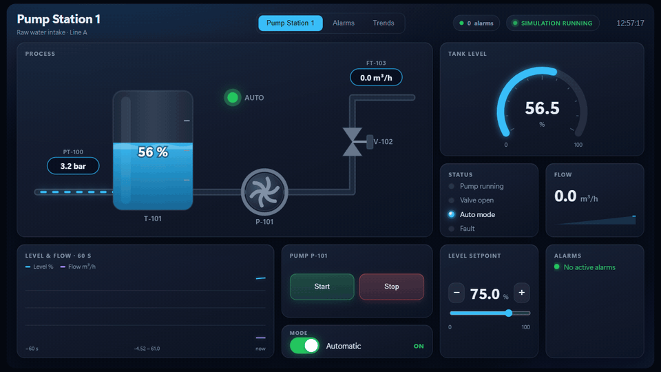
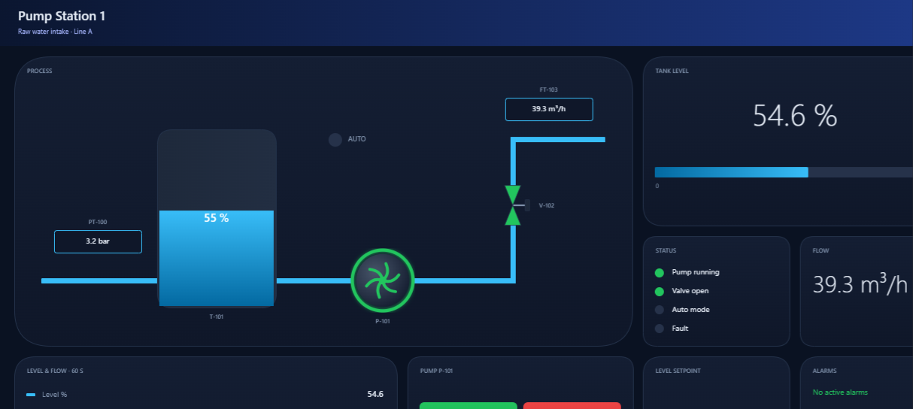
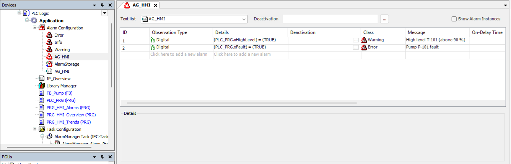

<div align="center">

# CODESYS MCP 工具包

**让 Claude 或任何 MCP 客户端，在你的 CODESYS V3.5 项目中读取、编写、编译并仿真结构化文本（ST）代码。**

[English](README.md) | 简体中文

[](LICENSE)
[](https://www.npmjs.com/package/@codesys/mcp-toolkit)


[](https://modelcontextprotocol.io)

</div>

这是一个 [MCP](https://modelcontextprotocol.io)（模型上下文协议）服务器。它在后台保持一个
CODESYS 会话，让 AI 助手直接操作你的真实项目：用真正的 CODESYS 编译器编译，在 CODESYS
自带的仿真中测试，而你可以实时看到代码的变化。

工具包支持任何能够通过 MCP 客户端调用工具的 AI 模型。我们用 OpenCode 测试了 DeepSeek V4.1 Flash、
通义千问 Qwen 3.6 Plus、GLM 5.3 和 MiniMax M3，均完成了全部步骤（见[已测试的模型](#已测试的模型)）。


## 主要功能

- **直接修改真实项目。** 以结构化文本编写 POU、方法、属性、接口、DUT 和 GVL。
- **用真正的编译器编译。** 错误会带上对象、行号和错误代码返回，包括还没有被任何任务调用的代码。
- **在仿真中测试。** 在 CODESYS 自带的仿真中运行、按周期单步执行、读取、写入和强制变量，
  无需安装其他软件，也不需要 PLC 硬件。
- **理解整个项目。** 提供项目大纲、I/O 列表、设备树和库接口，无需逐个读取对象。
- **过程可见。** 实时面板显示项目树、正在编写的代码和编译结果，每个改动都可以接受或还原。
- **绝不连接真实控制器。** 唯一的在线连接是 CODESYS 自带的仿真，每次在线操作前都会先检查。

## 快速开始

### 环境要求

- Windows，安装 **CODESYS V3.5** 及其 **Scripting**（脚本）插件。已在 SP21 和 SP22
  上测试，SP16 及以上版本应该都可以使用。
- **Node.js 20** 或更高版本。

施耐德 EcoStruxure Machine Expert V2.3（`LogicBuilder.exe`）同样可用：只设置
`--codesys-path`，不要设置 `--codesys-profile`，因为 Machine Expert 没有配置文件。
详见 [Machine Expert 说明](docs/machine-expert-testing.md)（英文）。

### 安装

```bash
npm install -g @codesys/mcp-toolkit
```

如果从 npm 下载很慢，可以使用 npmmirror 镜像：

```bash
npm install -g @codesys/mcp-toolkit --registry=https://registry.npmmirror.com
```

### 在 OpenCode 中使用

在项目文件夹的 `opencode.json` 中（或 `~/.config/opencode/opencode.json`）加入：

```json
{
  "$schema": "https://opencode.ai/config.json",
  "mcp": {
    "codesys": {
      "type": "local",
      "command": [
        "codesys-mcp-tool",
        "--codesys-path", "C:\\Program Files\\CODESYS 3.5.22.40\\CODESYS\\Common\\CODESYS.exe",
        "--codesys-profile", "CODESYS V3.5 SP22 Patch 4",
        "--workspace", "C:\\PLC\\Projects"
      ],
      "enabled": true
    }
  }
}
```

运行 `opencode mcp list`，应能看到 `codesys` 显示为已连接（connected）。

### 其他客户端

Cline、Trae、通义灵码、Cursor、Claude Desktop 等使用 `mcpServers` 配置的客户端，
一般都采用下面的格式（具体位置见各客户端的 MCP 设置）：

```json
{
  "mcpServers": {
    "codesys": {
      "command": "codesys-mcp-tool",
      "args": [
        "--codesys-path", "C:\\Program Files\\CODESYS 3.5.21.0\\CODESYS\\Common\\CODESYS.exe",
        "--codesys-profile", "CODESYS V3.5 SP21",
        "--workspace", "C:\\PLC\\Projects"
      ]
    }
  }
}
```

`--codesys-path` 和 `--codesys-profile` 可以省略，省略时服务器会使用 Program Files 下
最新安装的 CODESYS 及其最新的配置文件。

### 试一试

> 创建一个名为 `BlinkDemo.project` 的项目。添加一个每秒翻转一次输出的功能块，在 `PLC_PRG`
> 中调用它，编译，并在仿真中证明输出确实在翻转。

服务器启动时，CODESYS 会在后台启动。首次冷启动需要 1 到 3 分钟，之后大约 10 秒。

## 已测试的模型

2026 年 11 月 13 日，使用 OpenCode 1.19.5 和 CODESYS V3.5 SP22 测试：每个模型都在没有人工
帮助的情况下完成了创建项目、读取并修改 `PLC_PRG`、编译、列出库和设备，以及运行仿真。

| 模型 | 结果 |
| --- | --- |
| DeepSeek V4.1 Flash | 全部通过 |
| Qwen 3.6 Plus | 全部通过 |
| GLM 5.3 | 全部通过 |
| MiniMax M3 | 全部通过 |


## 实时查看 AI 的工作

有三种方式：

- **实时面板（MCP Apps 卡片）。** 在支持 [MCP Apps](https://modelcontextprotocol.io/extensions/apps)
  的客户端中，打开或创建项目后，面板会以卡片形式显示在对话中：项目树、正在编写的代码、
  编译问题，以及每个改动的“接受”和“还原”。
- **浏览器中的工作区。** 在其他客户端中，让模型“打开 CODESYS 工作区”（`open_workspace`），
  同样的界面会在浏览器中打开，只监听本机 127.0.0.1，并带有访问令牌。浏览器不会自动打开。
- **CODESYS 窗口。** 启动参数加上 `--show-window`，CODESYS 会以正常窗口运行，而不是在后台
  无界面运行。模型创建或修改的每个对象都会在编辑器标签页中打开，可以直接看到新写的代码；
  仿真运行时，打开的编辑器会显示变量的实时值。工具包不会自动关闭这个窗口。


## HMI 操作画面

让 Claude 为你的程序设计操作画面：带储罐、泵、风机、阀门和流动管道的工艺流程图，以及仪表盘、
数值、趋势图、状态灯、报警、按钮、开关和设定值，全部绑定到 PLC 变量。



- **完整的 HMI，而不只是一个画面。** 多个页面（总览、单元、报警、趋势、设置）共用一个页眉，
  页眉链接到每个页面并统计所有页面的活动报警。`hmi_template` 为每种页面提供良好的布局。
  面板尺寸：1280x720、1920x1080、1024x768 或 800x480。
- **操作面板（faceplate）。** 点击泵、风机或阀门会弹出面板：模式开关、启动/停止或开/关、复位、
  实时数值和设定值。
- **Claude 会检查自己的设计。** `hmi_screenshot` 把画面作为图片返回给 Claude，它能发现重叠、
  空白或不清楚的标签并自行修正。
- **在浏览器中实时运行。** 让 Claude 打开 HMI（`open_hmi`）。页面由工具包在 127.0.0.1 上提供，
  并带有访问令牌。CODESYS 仿真运行时显示实时数值，泵会转动，管道会流动；按钮、开关和设定值
  写入仿真，在没有硬件之前就能操作你的程序。
- **管道自动连接。** 储罐、泵、风机、阀门和三通都有命名接口（如 `T-101.right`、`P-101.in`），Claude 只需说明管道连接哪两个接口，
  工具包会以直角自动布线，在浏览器和 CODESYS 中都能精确对接。
- **与项目一起保存。** 画面保存在项目文件旁边的 `<项目名>.hmi.json` 中。

HMI 只写入 CODESYS 自带的仿真，不会连接真实控制器。

`hmi_export_codesys` 还能把同一个画面生成为项目中的原生 CODESYS 可视化（不用 CODESYS 自带的灯和按钮样式）：
渐变卡片、嵌入图片池的 SVG 泵/风机/阀门符号、实时数值、液位和棒图、按钮、开关、设定值和报警行，
它是普通的可视化对象，随应用程序一起使用（我们在 CODESYS 仿真中验证过，未在真实控制器上测试）。

多页 HMI 会生成为每页一个可视化，页眉中有页面按钮；第一页设为 TargetVisu 和 WebVisu 的起始页；
运行中的泵和风机会转动；操作面板生成为 CODESYS 对话框；用户组（Operator、Maintenance、Admin）
配有登录按钮（用户和密码由你在 Visualization Manager 中添加）。



报警是 CODESYS 自己的报警，而不是 HMI 中的副本：导出会创建报警配置（Alarm Configuration）中的
报警组，包括观察条件、报警类别和报警消息，由 CODESYS 的报警管理器在 PLC 中计算。在仿真中触发
故障后，报警组报告一个活动报警；故障消失后它仍保持待确认状态，直到被确认，这正是 Error 类报警
应有的行为。



CODESYS 的脚本无法创建趋势、仪表或报警表元素，所以趋势显示当前值，仪表显示为棒图，报警页在
报警活动时显示一行（可在 CODESYS 自带的报警表中确认报警，报警表可从工具箱添加）。已在 CODESYS
V3.5 SP21 的仿真中验证。可视化需要 CODESYS 库存储库中有 `FloatingPointUtils` 库；如果缺少，导出会提示。

## 可用操作

所有操作都通过一个 MCP 工具 `codesys` 完成，每个操作对应一个 action。
[参考文档](docs/reference.md)（英文）详细说明了每一个操作。

| 类别 | 操作 |
| --- | --- |
| **项目** | `open_project` `create_project` `save_project` `close_project` `codesys_status` |
| **读取代码** | `get_project_tree` `read_objects` `search_code` `get_outline` |
| **修改代码** | `write_object` `create_object` `create_graphical` `delete_object` `rename_object` |
| **编译** | `compile` |
| **库** | `list_libraries` `add_library` `remove_library` `get_library_api` `get_signature` |
| **代码导航** | `find_references` `rename_symbol` |
| **任务与 I/O** | `list_tasks` `configure_task` `get_io_list` `get_devices` `find_device` `add_device` |
| **改动跟踪** | `checkpoint` `get_changes` `revert_object` |
| **仿真** | `codesys_sim_start` `codesys_sim_stop` `codesys_sim_status` `codesys_sim_control` `codesys_sim_cycle` `codesys_sim_read` `codesys_sim_write` `codesys_sim_force` `codesys_sim_unforce` `codesys_sim_test` |
| **跟踪（Trace）** | `trace_setup` `trace_record` |
| **调试** | `breakpoint_set` `breakpoint_clear` `debug_status` `debug_step` `debug_continue` |
| **HMI 画面** | `hmi_save_screen` `hmi_template` `hmi_screenshot` `hmi_export_codesys` `hmi_list` `hmi_delete_screen` `open_hmi` |
| **辅助** | `batch` `wait` `help` `open_workspace` |

`batch` 可以在一次调用中执行最多 50 个操作，比逐个调用快得多。

有些操作超出了 CODESYS 脚本 API 文档的范围，使用 IDE 内部的 CODESYS 服务：`get_signature`、
`find_references`、`rename_symbol`、`trace_setup`、`trace_record`、调试操作、`hmi_export_codesys`
（包括报警和用户组）以及 `--show-window`。它们属于**实验性功能**：已在 CODESYS V3.5 SP21 和 SP22 上
验证（见[更新日志](CHANGELOG.md)），在其他版本上可能提示功能不可用，或无法正常工作。

Claude 编写结构化文本，并可用 `create_graphical` 根据梯级、网络或步骤的简单描述创建梯形图（LD）、
FBD 和 SFC 程序及功能块，由 CODESYS 绘制。已有的图形化代码可以以 PLCopenXML 形式读取，但还不能
就地编辑。不支持 CFC。

## 安全

- **不连接真实控制器。** 工具包不会登录或下载到控制器，只会连接 CODESYS 自带的仿真，
  每次在线操作前都会检查仿真模式是否开启。
- **一次授权涵盖所有操作，** 包括修改或删除项目代码的操作。请在副本上工作，或使用版本控制。
- **改动可以撤销。** 打开项目时会自动创建检查点，`revert_object` 可以把对象（包括其方法和
  属性）恢复到检查点时的状态。
- **自动保存。** 默认每次改动后都会保存项目；使用 `--no-autosave` 只在需要时保存。
- **仿真不会改动项目。** 仿真运行时禁止编辑，设备上的仿真设置也不会被保存。

## 更多内容（英文）

- [全部启动参数](README.md#configuration)
- [故障排除](README.md#troubleshooting)
- [工作原理](README.md#how-it-works)
- [开发与测试](README.md#development)
- [参与贡献](CONTRIBUTING.md)

欢迎提交 Issue 和 Pull Request，中文或英文均可。

## 致谢

感谢 Zhen Yang（Alfabete-spec）审阅本中文文档。

## 许可证

[MIT](LICENSE)

CODESYS 是 CODESYS GmbH 的商标。本项目为独立项目，与 CODESYS GmbH 无关联，也未获其认可。

---

本文档对应 2026 年 11 月 14 日的英文 README。如有出入，以[英文版](README.md)为准。
