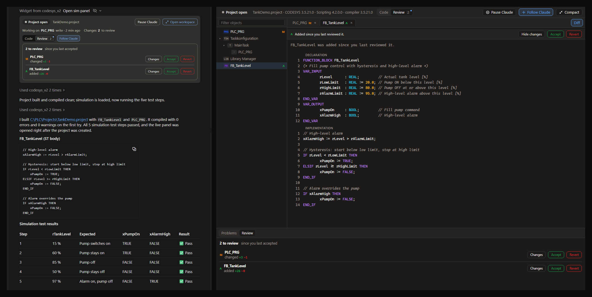
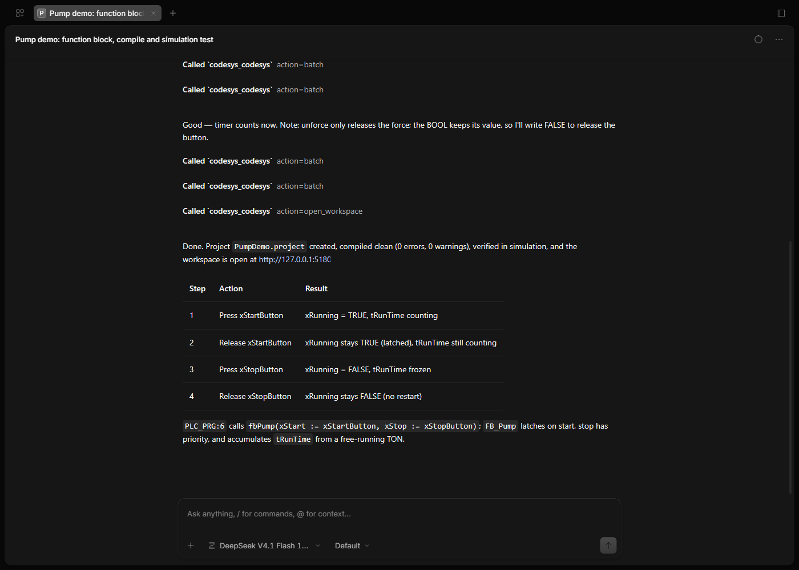
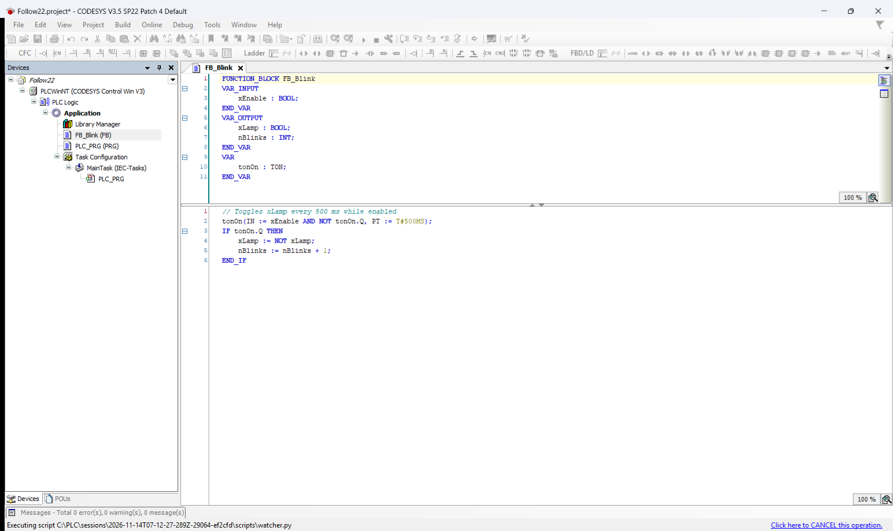
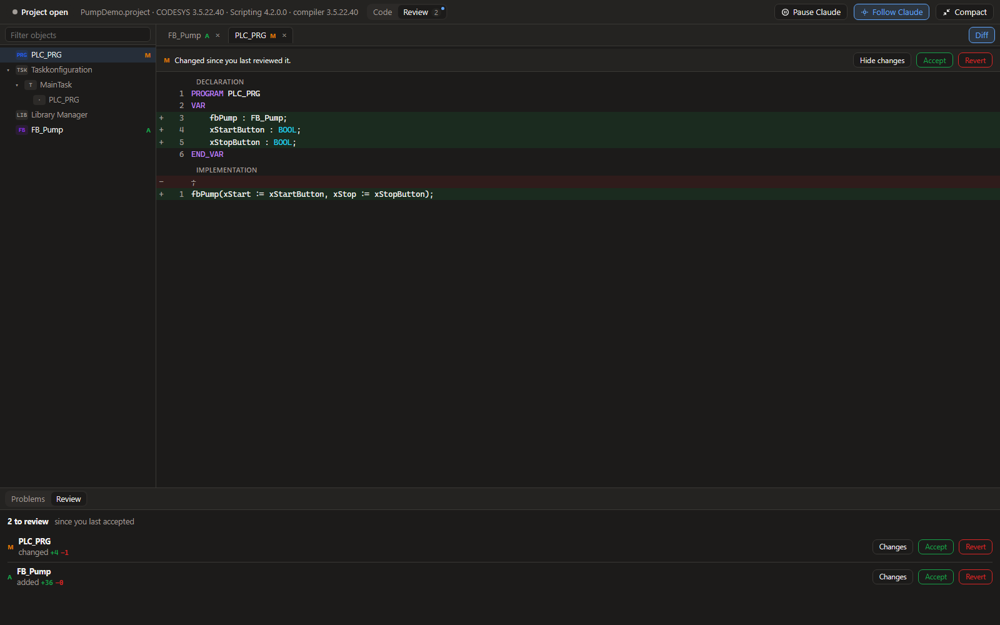

<div align="center">

# CODESYS MCP 工具包

**让 Claude 或任何 MCP 客户端，在你的 CODESYS V3.5 项目中读取、编写、编译并仿真结构化文本（ST）代码。**

[English](README.md) | 简体中文

[](LICENSE)
[](https://www.npmjs.com/package/@codesys/mcp-toolkit)


[](https://modelcontextprotocol.io)

</div>

这是一个 [MCP](https://modelcontextprotocol.io)（模型上下文协议）服务器。它在后台保持一个
CODESYS 会话，让 AI 助手直接操作你的真实项目：用真正的 CODESYS 编译器编译，在 CODESYS
自带的仿真中测试，而你可以实时看到代码的变化。它不绑定 Claude：DeepSeek、通义千问（Qwen）、
GLM、MiniMax 等模型通过 OpenCode 等客户端同样可以使用。



## 主要功能

- **直接修改真实项目。** 以结构化文本编写 POU、方法、属性、接口、DUT 和 GVL。
- **用真正的编译器编译。** 错误会带上对象、行号和错误代码返回，包括还没有被任何任务调用的代码。
- **在仿真中测试。** 在 CODESYS 自带的仿真中运行、按周期单步执行、读取、写入和强制变量，
  无需安装其他软件，也不需要 PLC 硬件。
- **理解整个项目。** 提供项目大纲、I/O 列表、设备树和库接口，无需逐个读取对象。
- **过程可见。** 实时面板显示项目树、正在编写的代码和编译结果，每个改动都可以接受或还原。
- **绝不连接真实控制器。** 唯一的在线连接是 CODESYS 自带的仿真，每次在线操作前都会先检查。

## 快速开始

### 环境要求

- Windows，安装 **CODESYS V3.5** 及其 **Scripting**（脚本）插件。已在 SP21 和 SP22
  上测试，SP16 及以上版本应该都可以使用。
- **Node.js 20** 或更高版本。

施耐德 EcoStruxure Machine Expert V2.3（`LogicBuilder.exe`）同样可用：只设置
`--codesys-path`，不要设置 `--codesys-profile`，因为 Machine Expert 没有配置文件。
详见 [Machine Expert 说明](docs/machine-expert-testing.md)（英文）。

### 安装

```bash
npm install -g @codesys/mcp-toolkit
```

如果从 npm 下载很慢，可以使用 npmmirror 镜像：

```bash
npm install -g @codesys/mcp-toolkit --registry=https://registry.npmmirror.com
```

### 在 OpenCode 中使用

在项目文件夹的 `opencode.json` 中（或 `~/.config/opencode/opencode.json`）加入：

```json
{
  "$schema": "https://opencode.ai/config.json",
  "mcp": {
    "codesys": {
      "type": "local",
      "command": [
        "codesys-mcp-tool",
        "--codesys-path", "C:\\Program Files\\CODESYS 3.5.22.40\\CODESYS\\Common\\CODESYS.exe",
        "--codesys-profile", "CODESYS V3.5 SP22 Patch 4",
        "--workspace", "C:\\PLC\\Projects"
      ],
      "enabled": true
    }
  }
}
```

运行 `opencode mcp list`，应能看到 `codesys` 显示为已连接（connected）。

### 其他客户端

Cline、Trae、通义灵码、Cursor、Claude Desktop 等使用 `mcpServers` 配置的客户端，
一般都采用下面的格式（具体位置见各客户端的 MCP 设置）：

```json
{
  "mcpServers": {
    "codesys": {
      "command": "codesys-mcp-tool",
      "args": [
        "--codesys-path", "C:\\Program Files\\CODESYS 3.5.21.0\\CODESYS\\Common\\CODESYS.exe",
        "--codesys-profile", "CODESYS V3.5 SP21",
        "--workspace", "C:\\PLC\\Projects"
      ]
    }
  }
}
```

`--codesys-path` 和 `--codesys-profile` 可以省略，省略时服务器会使用 Program Files 下
最新安装的 CODESYS 及其最新的配置文件。

### 试一试

> 创建一个名为 `BlinkDemo.project` 的项目。添加一个每秒翻转一次输出的功能块，在 `PLC_PRG`
> 中调用它，编译，并在仿真中证明输出确实在翻转。

服务器启动时，CODESYS 会在后台启动。首次冷启动需要 1 到 3 分钟，之后大约 10 秒。

## 已测试的模型

2026 年 11 月 13 日，使用 OpenCode 1.19.5 和 CODESYS V3.5 SP22 测试：每个模型都在没有人工
帮助的情况下完成了创建项目、读取并修改 `PLC_PRG`、编译、列出库和设备，以及运行仿真。

| 模型 | 结果 |
| --- | --- |
| DeepSeek V4.1 Flash | 全部通过 |
| Qwen 3.6 Plus | 全部通过 |
| GLM 5.3 | 全部通过 |
| MiniMax M3 | 全部通过 |



## 实时查看 AI 的工作

有三种方式：

- **实时面板（MCP Apps 卡片）。** 在支持 [MCP Apps](https://modelcontextprotocol.io/extensions/apps)
  的客户端中，打开或创建项目后，面板会以卡片形式显示在对话中：项目树、正在编写的代码、
  编译问题，以及每个改动的“接受”和“还原”。
- **浏览器中的工作区。** 在其他客户端中，让模型“打开 CODESYS 工作区”（`open_workspace`），
  同样的界面会在浏览器中打开，只监听本机 127.0.0.1，并带有访问令牌。浏览器不会自动打开。
- **CODESYS 窗口。** 启动参数加上 `--show-window`，CODESYS 会以正常窗口运行，而不是在后台
  无界面运行。模型创建或修改的每个对象都会在编辑器标签页中打开，可以直接看到新写的代码；
  仿真运行时，打开的编辑器会显示变量的实时值。工具包不会自动关闭这个窗口。





## 可用操作

所有操作都通过一个 MCP 工具 `codesys` 完成，每个操作对应一个 action。
[参考文档](docs/reference.md)（英文）详细说明了每一个操作。

| 类别 | 操作 |
| --- | --- |
| **项目** | `open_project` `create_project` `save_project` `close_project` `codesys_status` |
| **读取代码** | `get_project_tree` `read_objects` `search_code` `get_outline` |
| **修改代码** | `write_object` `create_object` `delete_object` `rename_object` |
| **编译** | `compile` |
| **库** | `list_libraries` `add_library` `remove_library` `get_library_api` |
| **任务与 I/O** | `list_tasks` `configure_task` `get_io_list` `get_devices` |
| **改动跟踪** | `checkpoint` `get_changes` `revert_object` |
| **仿真** | `codesys_sim_start` `codesys_sim_stop` `codesys_sim_status` `codesys_sim_control` `codesys_sim_cycle` `codesys_sim_read` `codesys_sim_write` `codesys_sim_force` `codesys_sim_unforce` |
| **辅助** | `batch` `wait` `help` `open_workspace` |

`batch` 可以在一次调用中执行最多 50 个操作，比逐个调用快得多。

第 2 版只编辑结构化文本。图形化语言（SFC、CFC、LD、FBD）的对象会显示在项目树中，可以以
PLCopenXML 形式读取，但不能编辑。

## 安全

- **不连接真实控制器。** 工具包不会登录或下载到控制器，只会连接 CODESYS 自带的仿真，
  每次在线操作前都会检查仿真模式是否开启。
- **一次授权涵盖所有操作，** 包括修改或删除项目代码的操作。请在副本上工作，或使用版本控制。
- **改动可以撤销。** 打开项目时会自动创建检查点，`revert_object` 可以把对象（包括其方法和
  属性）恢复到检查点时的状态。
- **自动保存。** 默认每次改动后都会保存项目；使用 `--no-autosave` 只在需要时保存。
- **仿真不会改动项目。** 仿真运行时禁止编辑，设备上的仿真设置也不会被保存。

## 更多内容（英文）

- [全部启动参数](README.md#configuration)
- [故障排除](README.md#troubleshooting)
- [工作原理](README.md#how-it-works)
- [开发与测试](README.md#development)
- [参与贡献](CONTRIBUTING.md)

欢迎提交 Issue 和 Pull Request，中文或英文均可。

## 许可证

[MIT](LICENSE)

CODESYS 是 CODESYS GmbH 的商标。本项目为独立项目，与 CODESYS GmbH 无关联，也未获其认可。

---

本文档对应 2026 年 11 月 14 日的英文 README。如有出入，以[英文版](README.md)为准。
