<div align="center">

# CODESYS MCP 工具包

**让 Claude 或任何 MCP 客户端，在你的 CODESYS V3.5 项目中读取、编写、编译并仿真结构化文本（ST）代码。**

[English](README.md) | 简体中文

[](LICENSE)
[](https://www.npmjs.com/package/@codesys/mcp-toolkit)


[](https://modelcontextprotocol.io)

</div>

这是一个 [MCP](https://modelcontextprotocol.io)（模型上下文协议）服务器。它在后台保持一个
CODESYS 会话，让 AI 助手直接操作你的真实项目：用真正的 CODESYS 编译器编译，在 CODESYS
自带的仿真中测试，而你可以实时看到代码的变化。

工具包支持任何能够通过 MCP 客户端调用工具的 AI 模型。我们用 OpenCode 测试了 DeepSeek V4.1 Flash、
通义千问 Qwen 3.6 Plus、GLM 5.3 和 MiniMax M3，均完成了全部步骤（见[已测试的模型](#已测试的模型)）。

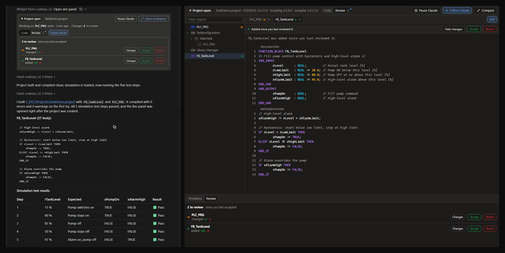

## 主要功能

- **直接修改真实项目。** 以结构化文本编写 POU、方法、属性、接口、DUT 和 GVL。
- **用真正的编译器编译。** 错误会带上对象、行号和错误代码返回，包括还没有被任何任务调用的代码。
- **在仿真中测试。** 在 CODESYS 自带的仿真中运行、按周期单步执行、读取、写入和强制变量，
  无需安装其他软件，也不需要 PLC 硬件。
- **理解整个项目。** 提供项目大纲、I/O 列表、设备树和库接口，无需逐个读取对象。
- **过程可见。** 实时面板显示项目树、正在编写的代码和编译结果，每个改动都可以接受或还原。
- **设计操作画面。** Claude 为你的程序设计实时 HMI：生产线工位总览、使用 ISO 10628-2 符号和 ISA-5.1
  仪表的工艺流程图、清晰的状态标记、数值、趋势和报警；可导出为带有 CODESYS 原生报警的 CODESYS 可视化，
  也可导出为用于文档的 P&ID 图纸。
- **便于交接。** 生成项目报告和基于项目内容的调试检查清单，并可把每个对象导出为纯文本以便用 git 管理。
- **绝不连接真实控制器。** 唯一的在线连接是 CODESYS 自带的仿真，每次在线操作前都会先检查。

## 快速开始

### 环境要求

- Windows，安装 **CODESYS V3.5** 及其 **Scripting**（脚本）插件。已在 SP21 和 SP22
  上测试，SP16 及以上版本应该都可以使用。
- **Node.js 20** 或更高版本。

施耐德 EcoStruxure Machine Expert V2.3（`LogicBuilder.exe`）同样可用：只设置
`--codesys-path`，不要设置 `--codesys-profile`，因为 Machine Expert 没有配置文件。
详见 [Machine Expert 说明](docs/machine-expert-testing.md)（英文）。

### 安装

```bash
npm install -g @codesys/mcp-toolkit
```

如果从 npm 下载很慢，可以使用 npmmirror 镜像：

```bash
npm install -g @codesys/mcp-toolkit --registry=https://registry.npmmirror.com
```

### 在 OpenCode 中使用

在项目文件夹的 `opencode.json` 中（或 `~/.config/opencode/opencode.json`）加入：

```json
{
  "$schema": "https://opencode.ai/config.json",
  "mcp": {
    "codesys": {
      "type": "local",
      "command": [
        "codesys-mcp-tool",
        "--codesys-path", "C:\\Program Files\\CODESYS 3.5.22.40\\CODESYS\\Common\\CODESYS.exe",
        "--codesys-profile", "CODESYS V3.5 SP22 Patch 4",
        "--workspace", "C:\\PLC\\Projects"
      ],
      "enabled": true
    }
  }
}
```

运行 `opencode mcp list`，应能看到 `codesys` 显示为已连接（connected）。

### 其他客户端

Cline、Trae、通义灵码、Cursor、Claude Desktop 等使用 `mcpServers` 配置的客户端，
一般都采用下面的格式（具体位置见各客户端的 MCP 设置）：

```json
{
  "mcpServers": {
    "codesys": {
      "command": "codesys-mcp-tool",
      "args": [
        "--codesys-path", "C:\\Program Files\\CODESYS 3.5.21.0\\CODESYS\\Common\\CODESYS.exe",
        "--codesys-profile", "CODESYS V3.5 SP21",
        "--workspace", "C:\\PLC\\Projects"
      ]
    }
  }
}
```

`--codesys-path` 和 `--codesys-profile` 可以省略，省略时服务器会使用 Program Files 下
最新安装的 CODESYS 及其最新的配置文件。

### 试一试

> 创建一个名为 `BlinkDemo.project` 的项目。添加一个每秒翻转一次输出的功能块，在 `PLC_PRG`
> 中调用它，编译，并在仿真中证明输出确实在翻转。

服务器启动时，CODESYS 会在后台启动。首次冷启动需要 1 到 3 分钟，之后大约 10 秒。

## 已测试的模型

2026 年 11 月 13 日，使用 OpenCode 1.19.5 和 CODESYS V3.5 SP22 测试：每个模型都在没有人工
帮助的情况下完成了创建项目、读取并修改 `PLC_PRG`、编译、列出库和设备，以及运行仿真。

| 模型 | 结果 |
| --- | --- |
| DeepSeek V4.1 Flash | 全部通过 |
| Qwen 3.6 Plus | 全部通过 |
| GLM 5.3 | 全部通过 |
| MiniMax M3 | 全部通过 |

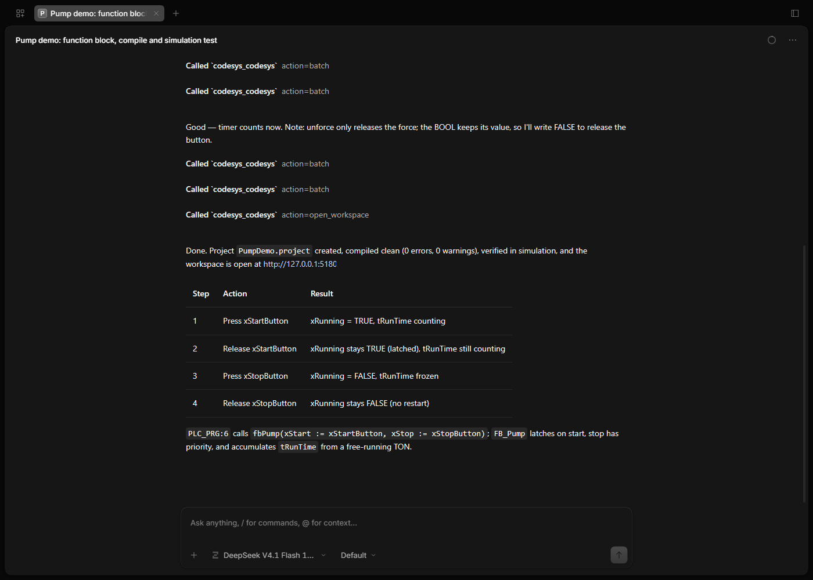

## 实时查看 AI 的工作

有三种方式：

- **实时面板（MCP Apps 卡片）。** 在支持 [MCP Apps](https://modelcontextprotocol.io/extensions/apps)
  的客户端中，打开或创建项目后，面板会以卡片形式显示在对话中：项目树、正在编写的代码、
  编译问题，以及每个改动的“接受”和“还原”。
- **浏览器中的工作区。** 在其他客户端中，让模型“打开 CODESYS 工作区”（`open_workspace`），
  同样的界面会在浏览器中打开，只监听本机 127.0.0.1，并带有访问令牌。浏览器不会自动打开。
- **CODESYS 窗口。** 启动参数加上 `--show-window`，CODESYS 会以正常窗口运行，而不是在后台
  无界面运行。模型创建或修改的每个对象都会在编辑器标签页中打开，可以直接看到新写的代码；
  仿真运行时，打开的编辑器会显示变量的实时值。工具包不会自动关闭这个窗口。

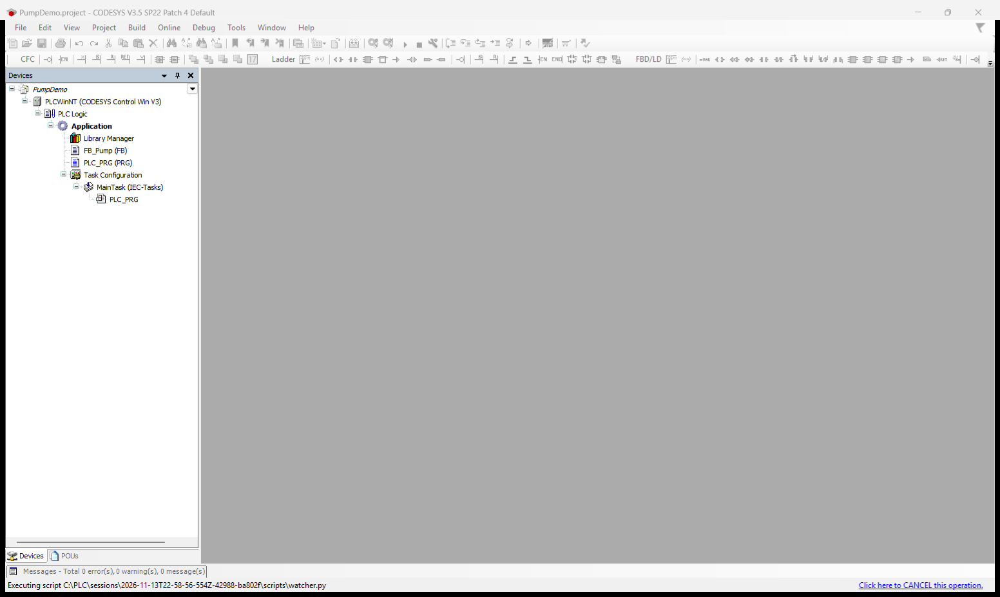

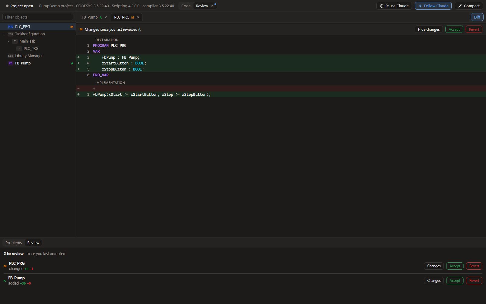

## HMI 操作画面

让 Claude 为你的程序设计操作画面：生产线各工位的总览、工艺流程图、带设定值的数值、趋势和报警，
全部绑定到 PLC 变量。外观是一套简洁、扁平的设计体系（Siemens iX 配色，遵循 ISA-101 高性能 HMI
做法）：颜色只表示状态或可操作的内容，从不用于装饰。

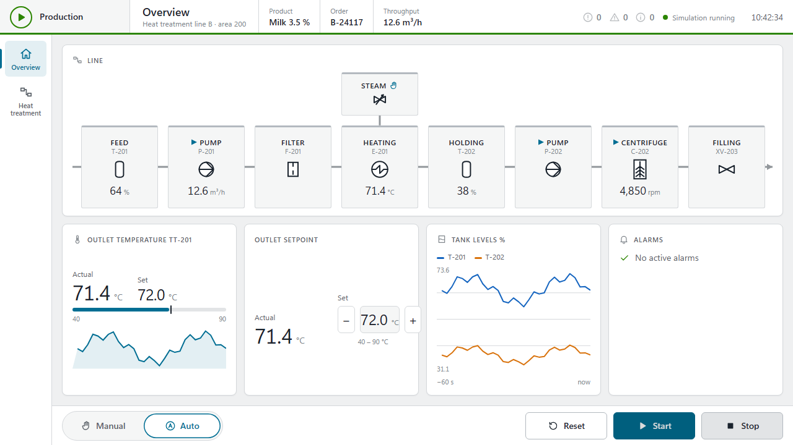

- **机器状态在框架中。** 机器状态（Production、Fault、Stopped 等）显示在页眉角落，页眉下方有一条
  同色细线；启动、停止、复位和手动/自动开关在底部栏；页眉统计活动的故障、警告和消息；页面在左侧导航栏。
  `hmi_template` 为每种页面提供良好的布局。面板尺寸：1280x720、1920x1080、1024x768 或 800x480。
- **工位总览。** `line` 卡片把工艺画成产品路径上的工位方块，每个方块显示图标、关键数值和状态；蒸汽等
  供给从上方接入其工位，点击方块打开该工位的页面。
- **符合标准的工艺流程图。** 符号按 ISO 10628-2 绘制（泵、风机、阀门、止回阀和调节阀、换热器、画在
  所驱动设备上的电机、搅拌器、分离机、过滤器、输送带等），仪表按 ISA-5.1 画成容器外的圆圈并连接到
  测量点，管道在命名接口（`T-201.right`、`P-201.in`）之间以直角自动布线，边缘带有管线名称和流向箭头。
- **状态一目了然，又不杂乱。** 三件互相独立的事，各有自己的标记，互不遮挡：名称前的运行状态（▶ 运行，
  ■ 停止）、名称后的模式（手动时显示手形；自动不显示）、符号角上的状况（黄色警告或红色报警；正常不显示）。
  关闭的阀门画成实心，与 P&ID 图纸一致。符号从不按状态填灰或着色，也没有任何动画。
- **标签自动摆放。** 每个名称、管线名称和读数都放在不碰到管道、设备或其他文字的位置，并保持在卡片内；
  储罐名称放在罐内。属于某台设备的数值（如调节阀开度）显示在其名称下方。
- **Claude 会检查自己的设计。** 保存画面时会检查布局（重叠、没有空间的标签），以及流程图是否构成真实
  的工艺：没有管道连接的设备、只有入口没有出口、只连接一侧回路的换热器、画在容器内的仪表、没有驱动任何
  设备的电机、把设备自身的数值画成单独传感器、以及给过滤器设置了运行状态。`hmi_screenshot` 把画面作为
  图片返回供查看。
- **你自己的符号。** Claude 可以把你需要的符号画成 SVG，或从 SVG 文件导入（`hmi_save_symbol`），并返回
  带接口标记的图片供检查。自定义 SVG 只允许少量元素和属性，脚本、样式、链接和外部图片都会被拒绝。
- **在浏览器中实时运行。** 让 Claude 打开 HMI（`open_hmi`）。页面由工具包在 127.0.0.1 上提供，并带有
  访问令牌。CODESYS 仿真运行时显示实时数值和趋势；按钮、开关和设定值写入仿真，在没有硬件之前就能操作
  你的程序。
- **浅色、深色和高对比度主题，** 所有页面一致；`accent` 可把公司品牌色用于高亮，其上的文字会自动变为
  黑色或白色以保持清晰。画面保存在项目文件旁边的 `<项目名>.hmi.json` 中，随项目一起并可纳入版本管理。

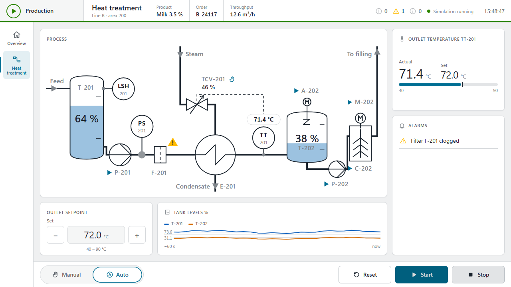

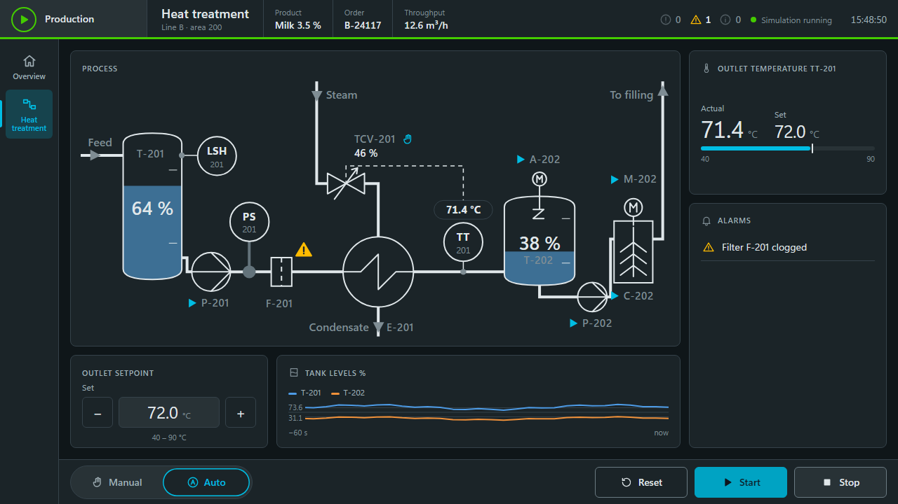

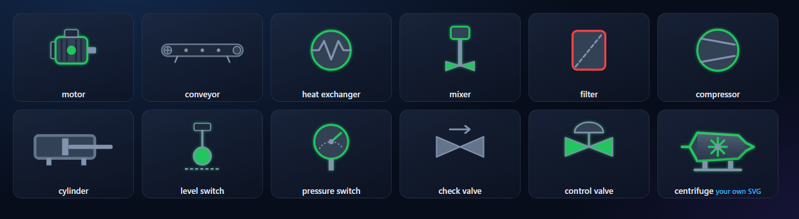

HMI 只写入 CODESYS 自带的仿真，不会连接真实控制器。截图使用已安装的 Microsoft Edge 或 Google Chrome。

### P&ID 图纸

`hmi_pid` 把画面中的工艺流程图导出为工程用 P&ID 图纸，用于文档和调试：同一张流程图，白底黑线，不含
任何实时内容，放在 A3 图纸上，带图框、所用符号的图例和标题栏（图号、版本、日期）。保存在项目旁边，
格式为 PDF、SVG 或 PNG。由于它来自 HMI 自己的流程图，不需要另外维护一份图纸。

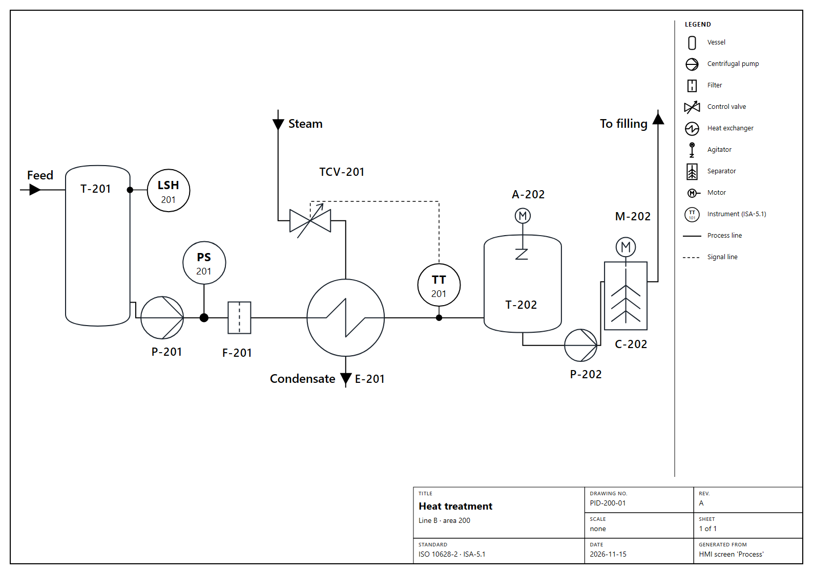

### 原生 CODESYS 可视化

`hmi_export_codesys` 把同样的画面生成为项目中的原生 CODESYS 可视化。它们是普通的可视化对象，随应用程序
一起使用（我们在 CODESYS 仿真中验证过，未在真实控制器上测试）：框架、卡片、符号、状态标记、标签和工位
方块都与浏览器中相同，使用 CODESYS 自己的元素和嵌入图片池中的图片绘制。生成的程序 `PRG_HMI_<画面>`
计算图片所需的内容（缩放后的棒图和液位、机器状态、报警数量）。Claude 会收到结果的图片。

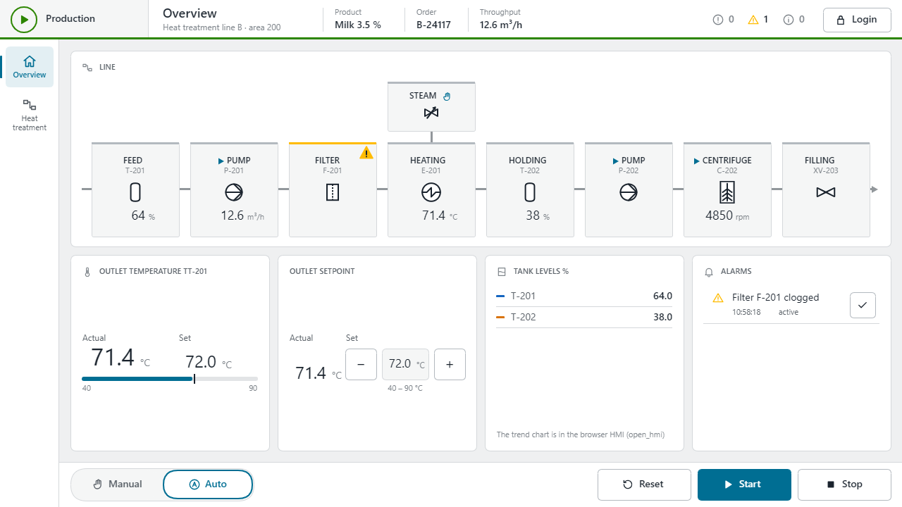

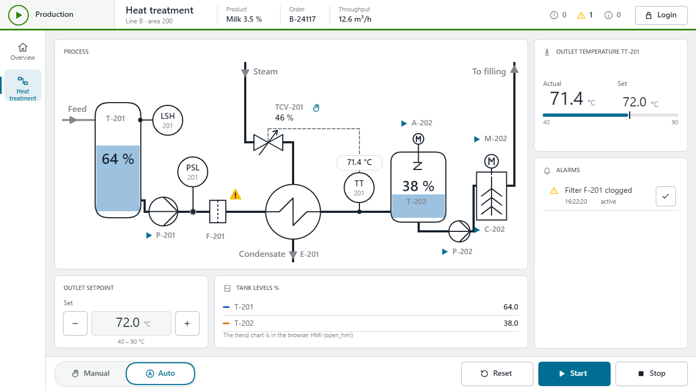

多页 HMI 会生成为每页一个可视化，带页面导航栏；第一页设为 TargetVisu 和 WebVisu 的起始页；操作面板
生成为 CODESYS 对话框；各页的报警进入 CODESYS 报警管理（Alarm Configuration，在 PLC 中带时间戳和确认）；
用户组（Operator、Maintenance、Admin）配有登录按钮（用户和密码由你在 Visualization Manager 中添加）。

可以把某个画块限制为某个用户组及以上：`access: {min: 'Maintenance'}` 让较低的用户组只能看到、不能操作，
`below: 'hide'` 则对它们隐藏。权限设置在 CODESYS 自己的元素上，未登录时同样生效。

报警是 CODESYS 自己的报警，而不是 HMI 中的副本：导出会创建报警配置（Alarm Configuration）中的
报警组，包括观察条件、报警类别和报警消息，由 CODESYS 的报警管理器在 PLC 中计算。在仿真中触发
故障后，报警组报告一个活动报警；故障消失后它仍保持待确认状态，直到被确认，这正是 Error 类报警
应有的行为。

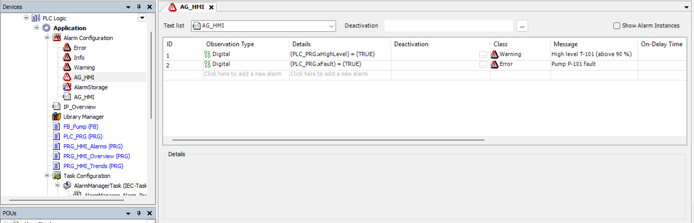

Claude 可以在仿真中测试这些报警：`alarm_status` 从 CODESYS 报警管理器读取每个报警的状态（正常、
活动、活动已确认、已消失但等待确认），`alarm_acknowledge` 像操作员一样确认报警。在浏览器 HMI 和
CODESYS 中，报警行在被确认之前一直显示，带有报警出现的时间、状态和确认按钮。

报警恢复正常后，CODESYS 运行时的报警会清除其时间，因此导出还会在 PLC 中加入报警历史：生成的 ST 代码把每个报警的
每次状态变化（使用 CODESYS 自己记录的变化时间）写入 RETAIN 环形缓冲区。`alarm_history` 列出这些记录，
带有 `history: 5` 的报警画块会在浏览器和 CODESYS 中显示最近的事件（`create_alarm_history` 可为自带报警的项目
加入同样的功能）。

仪表与浏览器中的弧形仪表相同（图片池中的图片，每 2.5% 一张），而不是 CODESYS 的金属仪表。趋势显示当前值：
CODESYS 趋势需要脚本目前无法创建的趋势记录。已在 CODESYS V3.5 SP21 的仿真中验证。可视化需要 CODESYS
库存储库中有 `FloatingPointUtils` 库；如果缺少，导出会在开始构建之前提示。

## 交接与版本管理

`project_report` 在项目旁边生成一份 Markdown 报告，供调试或接手设备的人使用：摘要、任务、I/O 列表和
设备树映射、CODESYS 报警、HMI 页面、库、设备和程序结构。报告最后是一份根据项目本身生成的调试检查
清单：每个任务的周期、每个输入输出、每个映射通道、每个报警、每个 HMI 页面以及保持型变量，都列为需要
在真实设备上检查的项目，另外还有安全和归档事项。Claude 所做的一切都只在 CODESYS 仿真中测试过，报告中
也会说明这一点。

`export_sources` 把项目导出为纯文本以便用 git 管理：每个 POU、方法、属性、动作、DUT、GVL 和接口一个
`.st` 文件，按项目树的结构放在文件夹中；梯形图、FBD 和 SFC 以 PLCopenXML 保存；`project.txt` 包含任务、
库、设备和报警；以及 HMI 画面。`.project` 文件是二进制的，这个文件夹让每次改动都能以差异的形式审阅。
再次导出时只重写有变化的文件，并删除已删除对象的文件。`compare_sources` 将当前打开的项目与这样的文件夹或另一个
`.project` 文件进行比较：列出只存在于其中一方的对象，并给出每个有变化对象的逐行差异。

## 可用操作

所有操作都通过一个 MCP 工具 `codesys` 完成，每个操作对应一个 action。
[参考文档](docs/reference.md)（英文）详细说明了每一个操作。

| 类别 | 操作 |
| --- | --- |
| **项目** | `open_project` `create_project` `save_project` `close_project` `codesys_status` |
| **读取代码** | `get_project_tree` `read_objects` `search_code` `get_outline` |
| **修改代码** | `write_object` `create_object` `create_graphical` `delete_object` `rename_object` |
| **编译** | `compile` |
| **库** | `find_library` `list_libraries` `add_library` `pin_library` `remove_library` `get_library_api` `get_signature` |
| **代码导航** | `find_references` `rename_symbol` |
| **任务与 I/O** | `list_tasks` `configure_task` `get_io_list` `get_devices` `find_device` `add_device` `device_parameters` `configure_device` |
| **改动跟踪** | `checkpoint` `get_changes` `revert_object` |
| **仿真** | `codesys_sim_start` `codesys_sim_stop` `codesys_sim_status` `codesys_sim_control` `codesys_sim_cycle` `codesys_sim_read` `codesys_sim_write` `codesys_sim_force` `codesys_sim_unforce` `codesys_sim_test` |
| **跟踪（Trace）** | `trace_setup` `trace_record` |
| **调试** | `breakpoint_set` `breakpoint_on_change` `breakpoint_clear` `debug_status` `debug_step` `debug_continue` `watch` |
| **报警** | `alarm_list` `alarm_status` `alarm_acknowledge` `alarm_history` `create_alarm_history` |
| **交接** | `project_report` `export_sources` `compare_sources` `create_recipes` |
| **HMI 画面** | `hmi_save_screen` `hmi_template` `hmi_screenshot` `hmi_export_codesys` `hmi_list` `hmi_delete_screen` `open_hmi` `hmi_save_symbol` `hmi_symbols` `hmi_delete_symbol` `hmi_translate` `hmi_pid` |
| **辅助** | `batch` `wait` `help` `open_workspace` `show_in_codesys` |

`batch` 可以在一次调用中执行最多 50 个操作，比逐个调用快得多。

有些操作超出了 CODESYS 脚本 API 文档的范围，使用 IDE 内部的 CODESYS 服务：`get_signature`、
`find_references`、`rename_symbol`、`trace_setup`、`trace_record`、调试操作、`hmi_export_codesys`
（包括报警和用户组）、报警操作以及 `--show-window`。它们属于**实验性功能**：已在 CODESYS V3.5 SP21 和 SP22 上
验证（见[更新日志](CHANGELOG.md)），在其他版本上可能提示功能不可用，或无法正常工作。它们不依赖 CODESYS 的界面语言：
原生 HMI 导出也在德文和中文界面下验证过。

Claude 编写结构化文本，并可用 `create_graphical` 根据梯级、网络或步骤的简单描述创建梯形图（LD）、
FBD、CFC 和 SFC 程序及功能块，由 CODESYS 绘制。SFC 可以包含选择分支、并行分支和跳转。读取 LD、FBD、CFC
或 SFC POU 时会得到同样的描述，因此 Claude 也能修改已有的图形化代码：修改描述后用 `replace: true` 发回即可。

## 安全

- **不连接真实控制器。** 工具包不会登录或下载到控制器，只会连接 CODESYS 自带的仿真，
  每次在线操作前都会检查仿真模式是否开启。
- **一次授权涵盖所有操作，** 包括修改或删除项目代码的操作。请在副本上工作，或使用版本控制。
- **改动可以撤销。** 打开项目时会自动创建检查点，`revert_object` 可以把对象（包括其方法和
  属性）恢复到检查点时的状态。
- **自动保存。** 默认每次改动后都会保存项目；使用 `--no-autosave` 只在需要时保存。
- **仿真不会改动项目。** 仿真运行时禁止编辑，设备上的仿真设置也不会被保存。

## 更多内容（英文）

- [全部启动参数](README.md#configuration)
- [故障排除](README.md#troubleshooting)
- [工作原理](README.md#how-it-works)
- [开发与测试](README.md#development)
- [参与贡献](CONTRIBUTING.md)

欢迎提交 Issue 和 Pull Request，中文或英文均可。

## 致谢

感谢 Zhen Yang（Alfabete-spec）审阅本中文文档。

## 许可证

[MIT](LICENSE)

CODESYS 是 CODESYS GmbH 的商标。本项目为独立项目，与 CODESYS GmbH 无关联，也未获其认可。

---

本文档对应 2026 年 11 月 14 日的英文 README。如有出入，以[英文版](README.md)为准。
